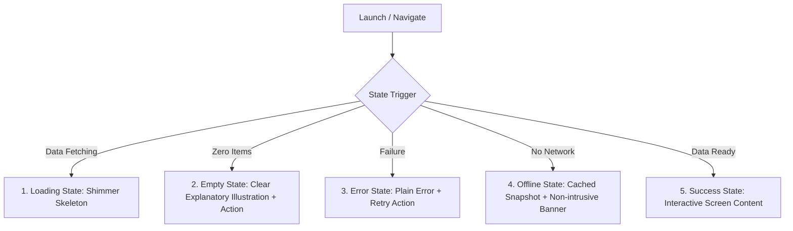

# Diet Planner — Complete UI Design Specification

> Author: Antigravity (UI Lane)  
> Task: U-00 (Phase PU)  
> References: `.agent/rules/design.md`, `design/ui-concepts/`, `docs/APP_BLUEPRINT.md`  
> Status: Implemented (Ready for Implementation Phase U-01 onwards)

---

## 1. Design Philosophy & Principles

1. **Calm, Honest, and Supportive**:
   - Health and nutrition can provoke anxiety or guilt. The UI strictly avoids shaming, punitive colors, or red warnings when exceeding calorie targets.
   - Streak counters never use guilt or loss-framing. Missed meals are marked as *"Not logged"*, never *0 kcal*.
   - Nutrient and calorie calculations are **estimates** and are explicitly marked as such across all screens.
2. **Speed to Core Actions**:
   - Primary routine action (logging a planned meal) takes **≤ 2 taps** from the home screen.
   - Primary action buttons are always prominent, full-width or pinned at thumb-friendly locations.
3. **Clarity and Predictability**:
   - One primary action per card or sheet.
   - Consistent, tokenized patterns across all screens.
4. **Accessibility First (Non-negotiable)**:
   - Contrast ratio ≥ 4.5:1 for standard text; ≥ 3:1 for large display text and key UI components.
   - Minimum interactive touch target: **48×48 dp**.
   - Fully legible and wrap-safe at **200% text scale** on a **360 dp width** viewport.
   - Screen-reader semantics: descriptive labels on every interactive element; images marked decorative or given alt descriptions.
   - Color is never used alone to convey status (paired with text badges or icons).
5. **Localization & RTL Readiness**:
   - Layouts use directional padding and alignments (`start` / `end`, never hard-coded `left` / `right`).
   - Supports English and Urdu. Urdu food names are rendered with **Noto Nastaliq Urdu** with appropriate line-height (1.8–2.0) to prevent diacritic clipping.

---

## 2. Design Tokens System

### 2.1 Color Tokens (Light & Dark Themes)

| Token Name | Light Theme | Dark Theme | Purpose / Usage |
|---|---|---|---|
| `color.primary` | `#1D6A50` | `#469E7F` | Primary interactive elements, eaten meal checkmarks, primary buttons |
| `color.primarySoft` | `#E2EFE8` | `#17382B` | Selected tab background, active badges, soft tint containers |
| `color.onPrimary` | `#FFFFFF` | `#0E231B` | Text/icons on top of `color.primary` |
| `color.background` | `#F6F5F1` | `#121614` | App canvas background (warm off-white / deep charcoal) |
| `color.surface` | `#FFFFFF` | `#1A211D` | Cards, sheets, top app bar, bottom nav bar |
| `color.surfaceSecondary`| `#F0EFEA` | `#242C27` | Counter buttons, secondary containers, input background |
| `color.border` | `#E4E2DA` | `#2D3731` | Card borders, dividers, subtle outlines |
| `color.borderStrong` | `#DAD7CD` | `#3E4B43` | Inactive chip outlines, inactive radio borders |
| `color.ink` | `#16201B` | `#EDF3EF` | Primary headings, prominent body text |
| `color.muted` | `#56635C` | `#9CA9A2` | Secondary captions, timestamps, placeholder text, hints |
| `color.ramadanBackground` | `#233B5E` | `#182840` | Ramadan banner card, Ramadan mode active indicator |
| `color.ramadanSoft` | `#C9D6EA` | `#2C4266` | Secondary text & borders inside Ramadan surfaces |
| `color.familyPotBg` | `#FBE9CC` | `#382613` | Family pot indicator chip background |
| `color.familyPotText` | `#7A4A10` | `#F2C48E` | Family pot indicator chip text/icon |
| `color.unreviewedBg` | `#F4EFEA` | `#332A24` | Unreviewed food badge background |
| `color.unreviewedText` | `#7A4A10` | `#EAA368` | Unreviewed food badge text |
| `color.reviewedText` | `#1D6A50` | `#469E7F` | Reviewed food badge text |

#### Nutrient Specific Colors (Always paired with textual labels)
| Nutrient | Light Token | Dark Token | Contrast Status |
|---|---|---|---|
| **Protein** | `#1D6A50` | `#469E7F` | ≥ 4.5:1 against card surface |
| **Carbs** | `#D9822B` | `#ECA04F` | ≥ 4.5:1 against card surface |
| **Fat** | `#3B6DB3` | `#6698DB` | ≥ 4.5:1 against card surface |
| **Fibre** | `#8A9A3C` | `#A6B748` | ≥ 4.5:1 against card surface |

---

### 2.2 Typography Scale

Bundled Fonts:
- **Latin & Numbers**: `Plus Jakarta Sans` (Weights: 400, 500, 600, 700, 800)
- **Urdu Titles & Subtitles**: `Noto Nastaliq Urdu` (Weights: 500, 700)

| Style Token | Size (sp) | Weight | Line Height | Letter Spacing | Purpose |
|---|---|---|---|---|---|
| `type.numberLarge` | 34 | 800 | 1.15 | -1.0 px | Hero calorie total, primary metrics |
| `type.titleLarge` | 28 | 800 | 1.20 | -0.5 px | Screen header titles (Today, Foods, Progress) |
| `type.titleMedium` | 20 | 800 | 1.25 | -0.3 px | Sheet headers, meal titles (Dinner, Breakfast) |
| `type.heading` | 18 | 700 | 1.30 | 0.0 px | Dish names (Chicken karahi, Daal mash) |
| `type.subheading` | 16 | 700 | 1.35 | 0.0 px | Section titles, prominent list headers |
| `type.body` | 15 | 500 | 1.45 | 0.0 px | Standard descriptions, explanations, option text |
| `type.bodyStrong` | 15 | 700 | 1.45 | 0.0 px | Button labels, bold list row values |
| `type.caption` | 13 | 400–500 | 1.40 | 0.0 px | Timestamps, portions (1 katori · 180 g), hints |
| `type.captionStrong`| 13 | 700 | 1.40 | 0.2 px | Active badges, section labels |
| `type.micro` | 12 | 600–700 | 1.30 | 0.3 px | Estimate pill, nutrient labels, tab bar text |
| `type.urduSubtitle` | 13 | 500 | 1.90 | 0.0 px | Urdu dish names (e.g., چنا چاٹ) |

---

### 2.3 Spacing Grid (4 dp Base)

| Token | Dimension (dp) | Typical Usage |
|---|---|---|
| `space.xxs` | 4 | Fine internal spacing, indicator dots, segmented gap |
| `space.xs` | 8 | Gap between related text items, badge padding |
| `space.sm` | 12 | Row items gap, chip margins, card padding tight |
| `space.md` | 16 | Screen horizontal edge padding, standard card gap |
| `space.lg` | 20 | Section separation, generous card padding |
| `space.xl` | 24 | Form field vertical separation, header margins |
| `space.xxl` | 32 | Major section gaps, empty state vertical margins |
| `space.hero`| 48 | Touch target bounding minimum, hero separation |

---

### 2.4 Corner Radii

| Token | Radius (dp) | Usage |
|---|---|---|
| `radius.control` | 10–14 | Stepper buttons, segmented control buttons, small inputs |
| `radius.button` | 16 | Primary buttons, large inputs, list action buttons |
| `radius.row` | 16 | Meal item list cards, search result cards |
| `radius.card` | 20 | Main summary card, hero card, modal bottom sheets |
| `radius.chip` | 999 (Capsule) | Filter chips, status badges, estimate pills |

---

## 3. Shared Components Specifications

### 3.1 Buttons
- **Primary Button**:
  - Height: 56 dp, radius: 16 dp.
  - Background: `color.primary`, text: `color.onPrimary` (16 sp, weight 700).
  - Tap target: 100% width or min 48 dp height.
- **Secondary Outlined Button**:
  - Height: 48 dp, radius: 14 dp.
  - Border: 1 px solid `color.primary`, background: `color.surface`, text: `color.primary`.
- **Text / Inline Button**:
  - Min touch target: 48×48 dp.
  - Text: `color.primary` (weight 700, 14–15 sp).
- **Destructive / Remove Button**:
  - Min touch target: 44×44 dp.
  - Muted icon (`color.muted`) with clear accessible label (e.g. `aria-label="Remove kheera salad"`).
  - Destructive action triggers an undo snackbar (5 s duration).

### 3.2 Badges & Status Chips
- **Estimate Badge**:
  - Capsule pill, height 24–28 dp, background `color.surfaceSecondary`, text `color.muted` (12 sp, weight 600).
  - Reads: *"Estimate"*.
- **Family Pot Badge**:
  - Capsule pill, background `color.familyPotBg`, text `color.familyPotText` (12 sp, weight 700).
  - Leading pot icon + text: *"Family pot"*.
- **Meal Status Indicator**:
  - **Eaten**: 36×36 dp circular icon container, background `color.primarySoft`, green checkmark icon (`color.primary`, stroke 2.5).
  - **Planned**: 36×36 dp circular border, dashed outline (2 px dashed `color.borderStrong`).
  - **Not Logged**: 36×36 dp dashed circular border with centered '?' in `color.muted`.
- **Catalogue Review Status**:
  - **Reviewed**: Green text `#1D6A50`, bold, 12 sp.
  - **Not yet reviewed**: Amber text `#7A4A10`, bold, 12 sp.

### 3.3 Steppers & Input Controls
- **Portion Stepper**:
  - Horizontal container with `color.surfaceSecondary` background, 14 dp radius.
  - Minus and Plus buttons: 44×44 dp touch target, 22 sp symbol.
  - Value label: min-width 36 dp, center-aligned, 16 sp weight 700, wrapped in an accessibility live region (`polite`).
- **Oil Level Selector**:
  - 3-segment control: `Light` (~1 tsp/katori), `Normal` (~2 tsp/katori), `Rich` (~4 tsp/katori).
  - Selected segment: surface elevation card with subtle shadow, primary text color.
- **Search Field**:
  - Height: 52 dp, radius: 16 dp, 2 px border (`color.primary` when active).
  - Leading search icon, trailing clear button (32×32 dp touch surface), helper caption explaining English & Roman Urdu support.

### 3.4 Nutrition Displays
- **Calorie Split Bar**:
  - Height: 12 dp, radius: 6 dp.
  - Dual fill: Eaten portion (`color.primary`), Planned portion (`#9CC7B4`), Remaining (`#EDEBE4`).
- **Macro Progress Bars**:
  - 4-column layout for Protein, Carbs, Fat, Fibre.
  - Label, current / target numbers (14 sp, weight 700), 4 dp high progress track with designated nutrient color.

### 3.5 App Scaffold & Bottom Navigation
- **Navigation Bar**:
  - Height: 72 dp, fixed at screen bottom, surface color with top border `color.border`.
  - 4 Navigation destinations:
    1. **Today**: Calendar/plate icon, default landing.
    2. **Foods**: Search magnifier icon.
    3. **Progress**: Line trend chart icon.
    4. **More**: Ellipsis menu icon.
  - Active state: pill background `color.primarySoft` with `color.primary` icon and bold label.

---

## 4. Screen States Framework (All 5 States Mandatory)

Every screen in the UI lane implements five explicit states:

1. **Loading State**:
   - Replaces content with tokenized shimmer skeletons matching final card dimensions (avoid generic full-screen spinners).
2. **Empty State**:
   - Friendly graphic or iconography.
   - Descriptive title and 1–2 line explanation.
   - Primary recovery call-to-action (e.g., *"Add your first food"*, *"Plan this week's meals"*).
3. **Error State**:
   - Supportive, calm copy explaining what went wrong in non-technical terms.
   - Dedicated "Try again" button.
   - Never exposes raw exception messages or stack traces.
4. **Offline State**:
   - Full access to all cached and local database content.
   - Subtle top bar badge: *"Offline mode · Changes will sync when connected"*.
5. **Success State**:
   - Standard presentation as specified in the catalog below.

---

## 5. Screen Catalog & States Matrix

### 5.1 Onboarding Flow (Task `U-06`)
- **Screens**:
  1. `Welcome`: Value proposition, local privacy pledge, start button.
  2. `Consent & Privacy Choice`: Local-only guest vs. opt-in diagnostics.
  3. `Goal Selection`: Maintain, gradual loss, gradual gain (strictly within safe policy limits).
  4. `About You`: Birth year, sex, height (cm/ft), weight (kg/lbs).
  5. `Activity Level`: Sedentary, lightly active, moderately active, very active.
  6. `Eligibility Gate`: Age check (18+) and special condition filter (pregnancy, breastfeeding, specific conditions). If ineligible, smooth handoff to **Manual-Only Mode** with supportive explanation.
  7. `Dietary Preferences & Allergens`: Veg/Non-veg/Halal, allergen exclusion list with prominent cross-contact warning.
  8. `Meal Schedule`: 3 to 6 daily slots (Breakfast, Lunch, Chai, Dinner, Late snack).
  9. `Cooking Richness`: Light (1 tsp oil/katori), Normal (2 tsp oil/katori), Rich (4 tsp oil/katori).
  10. `Target Summary`: Calorie and macro recommendation with explicit *"How we calculated this"* breakdown link.
- **States Required**:
  - `Loading`: Plan generation animation.
  - `Empty`: N/A (form steps).
  - `Error`: Inline field validation errors (e.g. non-realistic heights or weights).
  - `Success`: Ready to transition to Today screen.

### 5.2 Today Screen (Task `U-07`)
- **Variants**:
  - `Standard Mode`: Eaten vs. planned calories, macro bars, next meal banner, today's meal cards list.
  - `Ramadan Mode`: Dark blue nocturnal theme (`#233B5E`), Sehri & Iftar countdown, Sehri/Iftar/Dinner slot schedule, Ramadan tips banner.
  - `Manual-Only Mode`: Calorie log without auto-generated meal targets (for excluded conditions or user preference).
  - `No Plan Yet`: Prompt to generate plan with 1-click wizard.
  - `NoPlanReason`: Explanation when strict restrictions leave no valid safe recipes in database.
- **States Required**:
  - `Loading`: Shimmer skeleton for summary card and meal list rows.
  - `Empty`: "No meals planned for today" with "Generate plan" or "Add meal".
  - `Error`: "Could not load today's plan" with Retry button.
  - `Offline`: Fully accessible offline using local SQLite cache.
  - `Success`: Interactive day timeline with quick-log action.

### 5.3 Meal Detail Screen (Task `U-08`)
- **Elements**:
  - Header: Meal type (e.g., Dinner), time, estimated kcal total.
  - Family Pot Card: Dish title, portion stepper (katori), dish-level oil richness toggle.
  - Side Items List: Breads (roti, naan) with counter, salads, condiments with remove button.
  - Action row: "Add food", "Replace dish" (links to Foods catalogue).
  - Bottom button: "Mark as eaten" / "Mark as planned".
- **States Required**:
  - `Loading`: Dish card shimmer.
  - `Empty`: Meal with 0 items with "Add dish" button.
  - `Error`: "Unable to load meal details" with back navigation.
  - `Success`: Full interactive adjustment sheet.

### 5.4 Portion Picker & Visual Guides (Task `U-09`)
- **Elements**:
  - Visual household measure guides: Katori (bowl), Pyala, Chamach (tablespoon/teaspoon), Roti diameter guide (small 6", medium 7", large 8").
  - "My Katori" Calibration sheet: Interactive slider to calibrate user's household bowl in grams/ml.
- **States Required**:
  - `Success`: Visual interactive cards with placeholder imagery.

### 5.5 Foods Search & Catalogue (Task `U-10`)
- **Elements**:
  - Search input with Roman Urdu and English fuzzy search.
  - Filter chips: All, Snacks, Daal & chana, Breads, Rice, Meat, Salads, Beverages.
  - Food card: English name, Urdu script title (`Noto Nastaliq Urdu`), standard serving size, calories, review badge (*Reviewed* or *Not yet reviewed*).
  - "Can't find a food? Tell us" feedback trigger.
- **States Required**:
  - `Loading`: 4 placeholder row shimmers.
  - `Empty`: "No foods found for '...'" with "Suggest this food" button.
  - `Error`: Search failure with retry.
  - `Success`: Paginated search results list.

### 5.6 Add / Replace / Quick-Add Sheets (Task `U-11`)
- **Elements**:
  - Quick-add sheet: Direct manual calorie and optional macro entry with strict input bounds.
  - Replace dish comparison sheet: Old dish vs. replacement dish macro difference.
- **States Required**:
  - `Input Error`: Validation messages for zero or negative values.
  - `Success`: Smooth bottom sheet dismissal on submit.

### 5.7 History Screen (Task `U-12`)
- **Elements**:
  - Calendar/timeline view of past days.
  - Historical snapshots: preserves exact calorie and macro values at log time.
- **States Required**:
  - `Empty`: "No past logs recorded yet".
  - `Success`: Day-by-day expandable log summaries.

### 5.8 Progress & Weight Tracking (Task `U-13`)
- **Elements**:
  - Weight metric card with trend line chart (accessible vector line with circular data points).
  - Range switch: Week vs. Month view.
  - "This week's eating" bar chart (Fully logged, Partly logged, Not logged).
  - "Add weight" bottom sheet with date, decimal weight input, and optional note.
- **States Required**:
  - `Empty`: "Log your first weight to see trends over time".
  - `Success`: Rendered interactive chart.

### 5.9 Shopping List (Task `U-14`)
- **Elements**:
  - Aggregated ingredients for the upcoming 3–7 days.
  - Categorized into raw produce, spices/oil, dairy, and ready-made staples.
  - Checkbox toggle for purchased items; strikethrough styling.
- **States Required**:
  - `Empty`: "Your shopping list is clear. Plan meals to generate a grocery list."
  - `Success`: Interactive checklist.

### 5.10 Reminders Screen (Task `U-15`)
- **Elements**:
  - Per-meal slot reminder toggles and time pickers.
  - Quiet hours window settings.
  - Permission status banner (with clear explanation if notifications are denied).
  - Ramadan toggle: automatic adjustment to Sehri and Iftar alert times.
- **States Required**:
  - `Permission Denied`: Banner with button linking to OS application settings.
  - `Success`: Form with switch controls.

### 5.11 More & Settings Screen (Task `U-16`)
- **Sections**:
  - Profile & Nutrition Targets (includes recalculate notice).
  - Dietary Preferences & Exclusions.
  - Cooking Richness Default.
  - App Language (English active; Urdu coming soon).
  - Units (Metric: kg, cm vs. Imperial: lbs, ft/in).
  - About, Nutrition Disclaimer, and Licenses.

### 5.12 Privacy & Data Management (Task `U-17`)
- **Elements**:
  - Diagnostics and crash consent toggles (opt-in).
  - "Export my data": Generates JSON file for device storage.
  - "Import data": File picker with schema validation and confirmation modal.
  - "Delete all data": High-friction 2-step confirmation with explicit warning dialog.

### 5.13 Transparency & Gentle Check-in (Task `U-18`)
- **Elements**:
  - *"How we calculated this"* sheet: Detailed breakdown of BMR formula (Mifflin-St Jeor), activity multiplier, deficit/surplus cap, and active TargetPolicy version.
  - *Gentle Check-in Sheet*: Displayed if logged intake is critically below policy floor for 3+ consecutive days. Contains compassionate, non-judgmental check-in copy and professional nutrition/medical support contact suggestions.

### 5.14 Dev Screen Gallery (Task `U-05`)
- **Elements**:
  - Developer-only routing hub organized by feature.
  - Matrix view allowing 1-tap launch of any screen in its 5 states using pre-configured mock view models from `lib/fixtures/`.

---

## 6. Accessibility & Verification Checklist (For Task U-19..U-21)

Every widget and screen must meet the following test criteria:
- [ ] **Contrast**: All text and meaningful boundaries verified ≥ 4.5:1 (Light and Dark).
- [ ] **Touch Targets**: Minimum bounding box 48×48 dp for all tap areas.
- [ ] **Text Scaling**: Tested at 200% dynamic font size at 360 dp viewport width without overflow errors (`RenderFlex overflowed`).
- [ ] **Screen Reader**: All icons carry `aria-hidden` or meaningful `Semantics(label: ...)`.
- [ ] **RTL Readiness**: Directional parameters only (`EdgeInsetsDirectional`, `AlignmentDirectional`). Verified in pseudo-locale.
- [ ] **Decoupled Architecture**: Zero imports from Drift, SQLite, HTTP, or domain services. Screens consume view models and callbacks only.
